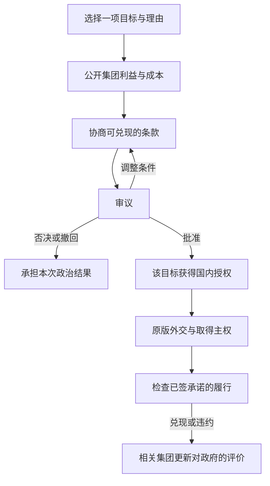

# 国家领土原则：国内博弈设计与现有实现审计

## 一、设计目标与证据标准

**本模组的主体是针对具体领土的国内政治博弈。** 玩家提出目标与理由，争取支持，作出有成本的承诺，再承担批准或否决的政治后果。法案通过是这一过程的结果；它不应成为“先点几个许可，再领取一套扩张增益”的额外按钮。

国内授权不等于国际承认、军事胜利、居民接受或生产效率提高。原版外交、恶名、战争、市场、迁移、歧视和人口变化继续承担这些结果。新领土的逐州接纳仍是一份独立法案，不能由宣称法案、殖民法律或文化相似自动代办。接纳后的一年整合是玩家明确要求的行政规则，不是文化同化的历史速度。

本文件前半部分是设计规范与旧效果审计，末尾“0.7.0-alpha.1当前运行规则”是本版代码的事实表；0.6.1实现记录已另行归档。**0.7已实现逐轮谈判和各国可用的付费铁路/海军基地合同，但完整设计中的税制、征兵、公共服务及资源收益谈判尚未接入。** 旧百分比不作为历史定量证据，设计目标也不等于已实现功能。

### 证据分级

| 类型 | 可以支持什么 | 不能支持什么 |
|---|---|---|
| 历史与政治经济研究 | 说明某些集团为何可能争取订单、土地、市场、安全、传教或居民权利，以及它们为何发生冲突 | 推出“帝国扩张使所有军工厂吞吐量+10%”或所有国家的工会都反对扩张 |
| Vic3原版机制 | 政治力量、认可度、合法性、预算、建筑投入产出、迁移资格、歧视等已有因果关系与作用域 | 证明一个自定义修正与现实存在相同幅度的因果关系；社区符号表也不是1.13实测 |
| 游戏抽象与平衡参数 | 在明确机制、付出、期限和反馈后，选取可测试的数值 | 冒充历史统计值，或为了凑齐四套法律收益而给每项填一个不同数字 |

为每项新效果记录：**受益/受损者、实际触发事实、作用对象、成本来源、持续与退出条件、原版对应机制、数值来源、实现状态**。缺少可解释的触发事实时，默认不发放效果。没有可靠定量证据时，可以使用公开标注的游戏参数；但不能先随意填数，再用历史叙述替它补理由。

正式设计先采用“原版实际收益＋国内政治反馈”。产业、建设、移民和全国政治能力的额外固定修正默认不启用；如果未来保留某项，就必须把它改为有明确政策措施和实际付出的条件效果。

## 二、国内博弈的完整流程

以下是设计流程，不是当前原型已完成的交互：

### 1. 提案：把目标和责任讲清楚

每份法案固定一个实际目标和一种任务：提出宣称、接纳本国拥有的一州、放弃一项失地宣称。玩家必须说明：为何要处理它、哪些集团受益、谁承担行政/军事/居民权益成本、准备作出什么承诺。军事占领不能替代主权，国内法案也不能直接取得他国土地。

领土原则是论证方向和集团偏好的背景。扩张原则与目标法案仍用于表达国内授权，但成熟重点、法律选择和目标批准不能演变为重复收费、重复等待的三份准战许可。重点区域只承担明确的长期行政投入；单州法案只审查该目标。当前原型的区域上限与固定等待是游戏参数，需按是否帮助形成政治选择重新评估。

### 2. 利益评估：支持来自具体诉求

| 集团 | 可能支持的实际诉求 | 可能反对的实际负担 | 必须避免的固定判断 |
|---|---|---|---|
| 武装力量 | 边境防御、基地与补给、明确军事任务、军队预算 | 无补给的远征、战争能力不足、目标分散 | 只要扩张就支持；法律名称自动增加其政治力量 |
| 实业家 | 有需求的订单、可进入的市场、可开发资源、基础设施投资 | 税负与融资成本、贸易中断、没有兑现的商业收益 | 看到资源名称就支持；取得领土就自动提高工厂效率 |
| 地主 | 具体土地/产权安排、出口与租金、维持当地精英利益 | 征税、劳动力流失、接纳方案改变产权或特权 | 所有地主都支持帝国；农业因此必然更高效 |
| 小市民 | 实际国家认同、既有主张、安全与本地就业 | 新税、物价、长期动员、违背其公民权偏好的安排 | 异文化人口必然导致同一幅度的反对 |
| 知识分子 | 与其实际意识形态一致的法理、权利或改革方案 | 统治方式、审查、歧视、承诺与实际政策冲突 | 自由主义者一律反帝；人文科技自动改变公民权 |
| 工会 | 工资、工作机会、社会服务、居民权益 | 战争税、征兵、工资竞争、公共支出被挤占 | 工人必然支持或反对海外扩张 |
| 乡村民众 | 当地土地、税费与征兵安排、边境安全 | 征兵、负担转嫁、劳动力与农产品价格冲击 | 所有战争都使乡村民众同样反对 |
| 虔信者 | 与具体宗教/意识形态有关的权利、机构与共同体安排 | 宗教冲突、世俗措施、对机构利益的损害 | 非同宗教目标只能产生反对，或传教必然带来支持 |

以上是要检查的政治诉求，不是对全球所有国家、时代和集团的历史定律。集团立场应同时受原版意识形态、领袖、目标、国内利益和已兑现政策影响。缺少可靠的目标数据时，界面标明“未评估”，不能用一个看似精确的支持分替代它。

取得土地和接纳居民分开计算。同一集团可以支持基地、采矿或贸易权益，却反对本国预算承担新居民的公共服务；也可以反对战争但支持已经取得领土的居民接纳。这是两个不同的分配问题，不是自动相反的固定立场。

### 3. 谈判：承诺必须付出，且可以被追责

| 可谈条款 | 受影响的利益 | 支持变化的依据 | 成本与履约证据 |
|---|---|---|---|
| 基地/军事设施 | 安全与军队部署 | 武装力量认为任务与资源相符 | 明确目标州、项目、交付期限；实际建设、补给与维护遵循原版 |
| 港口、铁路等基础设施 | 市场接入、运输与商业机会 | 有相关利益的集团认可投资方案 | 承诺的是项目而非免费建设速度；核对建筑增量及原版预算 |
| 税收和融资安排 | 国内谁承担扩张费用 | 承担负担的集团能看到支出如何分配 | 不能只勾选“保证低税”就加分；核对税制/预算，持续负担不得在批准后被静默取消 |
| 征兵与战争任务 | 谁承担战争风险、目标是否可控 | 军事与民生集团根据真实动员方案改变立场 | 方案必须对应可验证的原版制度；没有接口的条款暂不可选 |
| 接纳、权利与公共服务 | 新居民的法定地位及服务义务 | 与居民权利有关的集团认可可执行方案 | 本州行政预留及实际法律；不把一个“平等”理由直接当成已消除歧视 |
| 承认失地、撤销主张 | 战争风险、国家认同、既有承诺 | 停止承担不可实现的目标，或损失象征与利益 | 逐目标处理；不删文化家园、不转移主权，说明既有承诺如何结清 |

承诺至少保存目标、受益集团、交付事项、基线、期限和财政/行政义务。支持修正是对**可信且已承担成本的政策条款**的反应，不是免费奖励。不能无限叠加同一承诺；换原则、读档、转手、撤回菜单或接纳不能刷新旧义务。

涉及战后建设的承诺可以在取得主权后开始交付，但法案审议时必须披露预算来源和条件。没有实际取得时，不因做不到建设而惩罚；已经取得后不兑现，则进入违约追责。预算未落实的空头承诺，不与已落实条款获得相同支持。

### 4. 审议：每一轮应提供可改变结果的选择

评估界面显示各集团支持/反对的原因、其政治力量、已承诺成本及争议条款。玩家应能在轮次之间增加有成本的承诺、调整权利或融资方案、撤回提案；已经开始的审议不能悄悄换成另一州。

所有政体共用同一基础概率。政体与权力结构影响的是某项理由是否可信、某项承诺是否可执行以及政治责任如何分配，不是“独裁天然50%通过”。共同基础率、支持分阈值和90天轮次都是可测试的游戏参数；它们不代表历史上通过这类法案的统计概率。

当前原型以集团政治力量加权S/O，90天一轮、三次成功或三次失败结束。可保留这些数据与节奏作为实现基础，但不能仅把玩家体验做成等待随机三连成功。若一轮没有新的诉求、条件或取舍，增加一次轮次没有增加国内博弈。

### 5. 批准与履约：国内授权就是过程的产物

通过记录目标授权和承诺，不直接改变生产效率、人口文化、国际承认或军事实力。接纳修正案通过后，本州承担行政项目并按既定一年规则整合；其他州继续独立审议。原版市场和建设系统决定投资后的实际产出。

兑现承诺带来相关集团的有限、暂时认可；违约损害相关集团对政府的信任，并影响未来谈判。反馈对象是履约关系，不是所有居民都因为法案名称更忠诚。合法性可以经政府支持与政治关系间接变化；不得将“帝国越扩张越合法”写成普遍因果规律。

集团认可度与原版政府合法性不是同一个指标。相关集团认可上升，并不保证合法性同步增加；政府组成、政治力量或原版计算条件没有改变时，合法性可以保持原值。界面与规则不得把两者混称“合法性收益”。

未获授权开战确实可能引起国内反对，但需要说明哪些集团为何反对、如何承担动员与预算成本。当前每月+2、每战上限20的统一额外厌战是旧原型的约束，不能替代国内谈判，也没有历史定量依据。正式设计应将未经授权的政治争议归入国内过程，避免再加一套统一战争难度修正；防御、收复与原版战争损耗仍应保持自己的逻辑。

## 三、四条原则的具体设计

| 原则 | 核心政治主张 | 需要争取的利益与主要分歧 | 正式设计中的效果 |
|---|---|---|---|
| 领土现状主义 | 既有边界与国内资源分配优先 | 外部方案必须说明为何优于国内投入；安全需要也可得到军方支持 | 调整论证与集团倾向；不自动加行政效率、减军方力量或加民生产业吞吐量 |
| 历史权利主义 | 依据具体既有主张、条约或国家认同处理领土 | 主张是否可信、代价是否值得、当地居民如何处理；传统利益未必一致 | 法理理由需要可检验依据；不因“历史”二字自动降低国际恶名或增加农林效率 |
| 战略边疆主义 | 用明确、有限的军事/交通目标保障安全 | 基地与补给、投入边界、谁承担财政与动员成本 | 让军事与基础设施条款进入谈判；不自动增加外交机动点或全国军费 |
| 帝国扩张主义 | 以海外权益、商业与国家地位支持较广的扩张方案 | 订单、市场、产权与居民权益的分配，以及持续治理和防卫承诺 | 让利益分配及更广泛义务成为争议；不免费提高军工全产业链效率、威望、合法性或集团力量 |

四条原则的差别应体现在“同一目标怎样得到国内支持”，不是四套永久属性包。基础倾向只能作为起点，不能覆盖与目标事实相反的集团利益。原则允许或偏好的理由不同，但本模组不额外授予越过原版外交、殖民、迁移或接受规则的能力。

## 四、现有buff/debuff逐项审计

以下数值来自0.6.1原型，不是历史测量值。此表给出后续设计处置；**本次文档修订没有声称这些处置已经执行到运行代码。**

| 现有设计 | 审计结论与因果问题 | 正式设计处置 |
|---|---|---|
| 原则直接给集团政治力量±10%～20% | 某集团从扩张获益，不等于立法名称立即使其社会财富或政治组织增加相同比例 | 取消无条件力量修正；保留可解释的偏好与谈判支持；实际力量仍由原版决定 |
| 固定集团倾向−2～+2，安全/接纳等修正±10～20分 | 可以表达初始政治判断，但不能保证全球每位领袖、意识形态与每个目标都同向 | 作为原型可调参数保留事实记录；正式评分须能被具体目标利益、意识形态与条款改变，不给标签最后决定权 |
| 现状行政+5%、帝国行政−5% | 海外义务可能消耗行政，但不应同时改变原有全国机构效率 | 改为具体重点/项目的行政预留；不凭原则增减全国行政产能 |
| 历史权威+25、边疆外交机动点+10 | 缺乏政策措施与这些能力之间的直接因果链 | 取消原则赠送；原版制度继续提供权威和外交能力 |
| 威望现状−5%、帝国+10% | 国家地位受实际战果、经济、军事实力与国际关系影响，选择国策本身不是成果 | 取消固定修正；尽量由原版实际成果处理，避免重复奖励 |
| 法律恶名产生−10%/+10%/+25%，衰减+5%/+15% | 国内自称有权利不等于外国承认；国策也不会令所有原版外交行为统一改变同一幅度 | 不全局修改；对外代价优先用原版目标与实际外交事件，国内成本在审议中承担 |
| 新宣称额外恶名0/2/5，独裁/民主目标倍率0.9/1.25 | 公开主张可能产生外交反应，但这些数值没有定量依据；仅按政体分配外交代价过于粗糙 | 与具体主张、既有权利、国际关系分开评估；不将目标政体作为普遍恶名价格表 |
| 军事物资花费+5%/+10% | 海外防卫需要支出，但不应凭原则使全国所有军用采购永久变贵 | 用真实军队、设施与维护负担；避免叠加无法对应行动的普遍军费税 |
| 各原则产业吞吐量+5%，帝国指定12类+10% | 订单、投资与市场机会不等于立即提高技术效率；煤铁等双用途产业也没有理由全部同时获益 | 取消免费、永久产业增益，优先用实际投资和订单；若未来保留临时动员抽象，须明确措施、付费、当地指定产业与结束条件。10%仅是此前用户提出的候选上限，非历史效应 |
| 新州建设效率+5%/+10%/+15%/+20% | 新区开发的困难或改善取决于人力、基建、制度与投资，不随法律名称自动改善 | 由实际项目形成建设投入；额外效率默认0，不能用它代替建设成本 |
| 新州移民吸引+15%/+10%/+5%/+10% | 移民取决于就业、工资、生活、权利与迁移资格，选择领土原则不直接改变这些条件 | 取消无条件吸引；允许明确的就业/迁居政策进入谈判，资格与实际吸引仍走原版 |
| 按原则统一调整歧视或生活水平变化的激进/效忠生成倍率 | 原因是实际歧视、生活变化与政治经历，不是“帝国”或“现状”标签本身 | 取消标签修正；原版继续处理这些来源。具体权利措施和违约可以触发相关政治反馈 |
| 取得时一律增加0%～5%激进派、0%～2%效忠派 | 对战争和统治的反应取决于当地与国内群体；无法把所有人口用同一比例概括 | 取消每次取得自动转换；仅在可解释的政治事件中处理有关群体，防止双算原版征服反应 |
| 接纳批准减少2%/3%激进派、增加2%/3%效忠派 | 法定接纳可能改变政治预期，但不等于权利已兑现，也不保证所有居民立刻认同 | 批准记录只确定法定义务；反馈随实际权利或服务履约而发生，不提前清除不满 |
| 取得领土合法性+6/+8/+12，完成接纳+3 | 成功可能凝聚某些支持，也可能恶化国内矛盾；帝国没有比历史权利必然多获6点的依据 | 不按原则自动发合法性；优先用兑现承诺后的集团认可与原版政府支持关系。任何未来限时合法性事件须单独说明政治受益者与触发事实 |
| 履约认可+2三年、违约认可−5/谈判分−10五年 | 政府信用与履约有关，机制方向可以解释；幅度和期限仍是游戏参数 | 保留“相关集团、有限、暂时、可追踪”机制；具体参数需平衡验证，不推广成全国统一奖励 |
| 基础率10%、分数阈值5/20、90天一轮、三成/三败、冷却730天 | 都是原型节奏和显示参数，不是历史通过概率 | 可以作为谈判原型的可调参数；检验玩家是否有实质选择，减少无意义等待 |
| 重点上限0/1/2/3、预留25/50/75与0/25/50、等待6/12月、改法锁5年 | 可以模拟有限行政关注，但现有分档未经工作量估计或游戏校准 | 只保留能表达明确投入与政治取舍的部分；不能把这些参数当作历史规律或重复准战门槛 |
| 法律治理倍率0.8/1/1.25及按人口、动乱、战损计价 | 人口与机构工作量、破坏后的治理任务有可解释联系；原则本身或异文化身份不等于固定成本高低 | 以实际服务、机构与治理任务解释预留；不用文化差异作能力低下的替代指标。现有公式是待验证工作量代理 |
| 本国独裁/民主行政倍率1.1/0.95，前统治者独裁/民主倍率1.15/1.0 | 政体名称不能直接说明行政效率、可接管机构或社会服务费用 | 用具体制度、服务与接管事实说明成本，移除无法对应这些事实的通用政体折扣/加价 |
| 殖民扩张/接纳倾向+15/−10或+20/−20，人文阶段各改变15分 | 土地收益与居民权益负担可以分开解释；但科技研究不使所有集团在同一天接受同一幅度的道德转向 | 保留两类诉求和科技提供的新论证条件；具体集团响应需按其利益与意识形态解释，数值只是待校准代理 |
| 接纳一年行政整合 | 是用户明确要求的玩法时间尺度；不能声称符合任何州的历史整合工期 | 保留逐州付款与独立期限，明确其行政抽象，文化/宗教/接受等级不被改写 |
| 未授权战争额外厌战每月+2、每战20 | 能迫使玩家办手续，却不说明国内有哪些人反对、如何争取他们 | 正式设计以国内反对、履约与预算过程处理争议；统一额外厌战列为应替换的旧原型约束，原版战争损耗照常 |

如果仍需要经济激励，只能作为一份具体条款的配套，而非原则自动礼包。例如，为一州铁路与工业开发提供已承担成本的投资，可使有受益预期的实业家支持；真实铁路和企业运营再产生原版经济收益。不需要再凭空给该州所有军工厂10%吞吐量来证明支持有回报。

若未来确实增加领土开发配套修正，仍遵守此前确定的州级范围：只针对合格的新取得普通州，原有州（包括原有非文化家园）、条约港和外国军事占领不受模组额外增益。原版订单、贸易或建设自然产生的经济影响可以传播到其他州，不将这种实际市场结果误认为模组给原始领土添加了buff。

旧0.6.1“一国只能有一个法案或整合项目”的排他规则属于原型状态管理限制，不是关于真实国家政治能力的结论。尤其不能用某州已获批准的一年行政项目，将其他目标的国内讨论无条件冻结一年；0.7已区分审议队列和已批准项目，当前槽位限制见后文。

## 五、政治场景示例与验收标准

西班牙选择北非一个目标时，先提出“航道安全”论证；须说明目标与航道/补给的关系，不能仅因在北非就认定理由成立。武装力量关注任务和基地，商业集团关注市场接入，乡村民众关注征兵和税负，权利相关集团关注占领后的居民安排。

玩家可以选择不同方案：较窄的军事目标与明确基地预算，或更广的商业开发并承诺运输和公共服务。它们的集团支持、义务与失败风险不同。通过后得到的是该目标的国内授权和合同式义务；基地、铁路、工资、生活水平与居民权利的结果仍由实际行动产生。取得以后，接纳该州又涉及服务和公民权的分配，必须另行谈判。此例是玩法场景，不是对某次西班牙历史决策的重建，也没有虚构的历史支持率。

验收至少要求：

1. 同一国家、同一目标，通过改变真实条款而非点击免费按钮，可以形成不同支持联盟。
2. 每个集团能显示“为什么支持/反对”；未知事实不会被当成已获得收益。
3. 承诺有明确目标、实际付出和期限，重复承诺、读档或换原则不能刷支持与奖励。
4. 轮次之间存在可影响结果的取舍；不能只等待随机审核后领取许可。
5. 法案通过不自动增加产能、改变文化或保证战胜；法定接纳与实际接受分开。
6. 占领利益与居民接纳意愿分别计算，不能用一州批准覆盖其他州。
7. 原版外交、市场、建设、迁移与歧视不被另一个无依据的永久属性体系覆盖。
8. 宣称、居民接纳、放弃失地都能形成国内博弈，适用于各国，不只西班牙示例。

## 六、参考研究与核查范围

以下书目用于核查机制方向与反例，不是百分比参数的来源。本次没有完成原始史料的定量研究或这些著作的逐页核查；不提供未查证的页码、引文、DOI或“研究证明+10%”之类结论。

- J. A. Hobson, *Imperialism: A Study*（1902）：可用于讨论国内经济利益与对外扩张之间的解释路径；是一个需要与其他解释比较的理论，不能推广为所有集团或国家的行为定律。
- Jennifer Pitts, *A Turn to Empire: The Rise of Imperial Liberalism in Britain and France*（2005）：用于检验“自由主义/知识分子天然反对帝国”的简单标签，区分意识形态、权利话语与具体扩张方案。
- John Darwin, *The Empire Project: The Rise and Fall of the British World-System, 1830–1970*（2009）：用于核查商业、安全、交通与帝国治理之间的联系；研究时段部分超出游戏范围，不直接移植所有结论。
- Jack S. Levy, “The Diversionary Theory of War: A Critique”，载 *Handbook of War Studies*（1989）：用于检验“政府合法性低所以开战，战胜必然提高合法性”的单一因果解释，而非为固定合法性奖励背书。

机制核查使用Vic3 1.13本体的实际集团、认可、合法性、建筑、预算和人口规则。下方社区CWT只检查接口符号；没有本体实测时，不声称条件效果、群体反馈或回调已经兼容。新增规则先做可追踪的国内过程，再校准参数，不能把未实现的政治机制藏在笼统的buff说明里。

---

## 0.7.0-alpha.1当前运行规则

0.6.1的完整事实表归档在 [LEGACY_0_6_IMPLEMENTATION.md](LEGACY_0_6_IMPLEMENTATION.md)。前文审计列举的是旧效果，当前版本已按下列范围替换，未实现的条款仍保留为设计目标。

### 已实现与未实现

| 功能 | 当前实现 |
|---|---|
| 国内审议 | 每90天一次谈判窗口；玩家可签付费承诺、查看集团账目、继续或撤回。关闭窗口不立即投票，可用决议重开；引擎超时行为需实测 |
| 集团数据 | 读取原版集团政治力量、对政府的认可及部分领袖立场；初始偏好和殖民/人文倾向仍是明确标注的游戏参数 |
| 实际条款 | 铁路、海军基地两个建设合同，适用于各国的宣称和接纳法案；不用于放弃宣称 |
| 履约 | 保存目标、基线、批准状态、期限和费用；按实际净新增建筑检查，相关集团认可有限增减 |
| 一年接纳 | 逐本国实际拥有的非家园普通州批准并付款；一年行政整合，不改文化、宗教、接受等级或人口政治状态 |
| 并行讨论 | 已付款整合不冻结新法案；当前工程限制仍为一份审议、一项已付款年度整合，每类建设合同一份未履约义务 |
| 原版经济与战争 | 不给固定产业、建设、移民、政治力量、合法性或人口奖励；不额外收宣称恶名或增加战争厌战；不使用战争回调加罚 |
| 待接入 | 税制、征兵、公共服务合同，详细资源/市场回报、宗教共同体与同胞人口、完整领袖/意识形态映射；未评估信息不计作已获得利益 |

### 合同的实际费用、对象与期限

- 勘察支出：`max(5000, ceil(目标州人口×0.01))`，实际从国库扣除；仅有足够黄金储备时可签，不能靠未付款的承诺增加支持。
- 规划人员：每份合同持续预留10行政力，签第二份时须仍有足够可用行政；此预留不代替原版建筑施工、就业和维护支出。
- 支持：相关集团在当前法案的支持分增加10。这是初始偏好刻度的一档，属于待校准的游戏参数，不是历史支持率；不增加其政治力量。
- 铁路必须已研究`railways`，海军基地必须目标沿海；两者均排除条约港。不创建免费建筑。
- 已有主权的目标按实际州对象绑定，签约时记录建筑基线，通过后开始三年交付期限；此后其他州的建设不算兑现。
- 外国宣称合同先绑定目标州区域；批准后最多等待五年取得该区域的普通州，取得时保存本国实际州对象与基线，再开始三年交付。若该区域已经有本国部分，不能先签这种外国合同，避免用旧部分冒充取得；取得普通主权后可经接纳法案为实际部分州签约。
- 未通过、否决或撤回：释放未批准合同的行政预留，勘察支出不退；不会删除以前已经批准的合同。
- 五年内未取得：关闭等待合同、释放预留，不以未建成建筑惩罚。取得后的失地、复得、改原则与读档不重置旧基线或期限；期限内必须实际拥有绑定州且净增至少一级。
- 兑现：相关集团认可+2三年；违约：相关集团认可−5、未来谈判信用−10五年。同行为修正先移除同名旧修正再添加，不反复叠加；新发生的真实履约/违约可更新其期限。其他集团不自动同幅度变化。

费用和期限不是史料拟合值。勘察费将人口规模转换为方案准备工作量，5000提供最小准备支出；行政预留表达规划人员占用，真实建设另付原版成本。支持10沿用偏好的一档，认可+2/−5选择较小、暂时的政治反馈。三年交付、五年等取得和90天轮次是游戏节奏参数，必须在1.13按国库、建设工期和政治结果校准，不能声称符合所有国家的历史行政速度。

### 可见的集团评分与论证条件

账目分别显示初始偏好、殖民倾向、理由与负担、政府关系、领袖、付费承诺和违约。原版`ig_approval×0.5`作为关系分，限制在−5到+5；只映射已存在领袖的`ideology_jingoist`和`ideology_pacifist`：前者对宣称+10、放弃−10，后者相反，接纳不套用战争立场。

安全理由仍需相邻或西班牙示例的航道依据，武装力量+15；“平等权利”只在国家实际实行多元文化及完全宗教分离时为知识分子/工会增加15，不因选择理由而改法律；正式行政接管在实际行政余额足以支持年度预算时为小市民增加10。原型的放弃宣称与战争负担参数保留为可见游戏刻度，非普遍历史规律。

政府/权力体制共用10%基础率，不再固定给君主/独裁等理由加分或给独裁/民主对象打行政和恶名价格标签。最终轮次概率仍为 `clamp(10+0.6S−0.4O+0.2(合法性−50)−风险−规模负担,5,85)%`。政治力量由原版提供，所有分数不是实际历史赞成百分比。低合法性影响阻力，但没有“低于40不许讨论”的额外门槛；破产、内战与主权资格仍按当前流程检查。

国内批准添加原版真实宣称/本模组目标授权，不赋予国际承认或主权；原版宣称可能影响外交目标，这是沿用的游戏抽象。重点区域的额外成熟等待、法定五年锁定和原型属性包均不再用于新流程。

### 接纳、并行与存档

年度行政预算为 `ceil((25+25×人口百万数)×(1+0.5×动乱+0.5×战损))`，没有原则、政体、文化接受程度或科技阶段的通用倍率。它是待校准的治理工作量代理；开始时快照并预留到结束，后续赤字不延长一年期限。一次仍只支持一项已付款年度项目；别的州可继续讨论与批准，等待项目槽位和预算。

法案和年度项目有分别固定的目标与编号；谈判另有轮次编号。旧窗口不能给另一法案/轮次投票或扣钱，旧项目计时不能完成新州。通知保存事件目标，建设合同独立保存目标、基线和期限；存读不产生新的支付、奖励或期限。

本版需要新测试档，不支持把旧alpha直接当作已迁移存档。旧修正有空定义/清理接口用于兼容引用，但不会还原旧版已经造成的主权、整合、宣称或人口变化。当前157项离线测试与CWT符号检查通过；真实1.13回调、国库作用域、建筑计数、动态窗口和存档格式仍未实测。详见 [TESTING.md](TESTING.md)。
