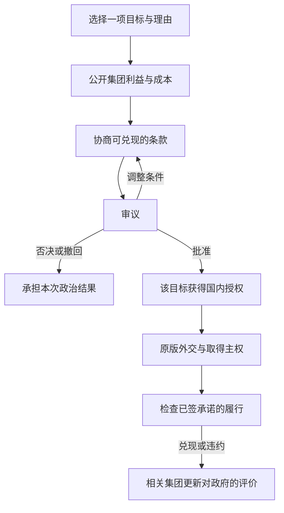

# 国家领土原则：国内博弈设计与现有实现审计

## 一、设计目标与证据标准

**本模组的主体是针对具体领土的国内政治博弈。** 玩家提出目标与理由，争取支持，作出有成本的承诺，再承担批准或否决的政治后果。法案通过是这一过程的结果；它不应成为“先点几个许可，再领取一套扩张增益”的额外按钮。

国内授权不等于国际承认、军事胜利、居民接受或生产效率提高。原版外交、恶名、战争、市场、迁移、歧视和人口变化继续承担这些结果。新领土的逐州接纳仍是一份独立法案，不能由宣称法案、殖民法律或文化相似自动代办。接纳后的一年整合是玩家明确要求的行政规则，不是文化同化的历史速度。

本文件分为两部分：前半部分是新的设计规范与效果审计；“现有0.6.1实现记录”以后是当前代码的事实表。**当前原型已有支持分、逐目标审议和西班牙示例承诺，但尚未实现完整的通用国内谈判流程。** 不能把后半部分现有的固定百分比解释为已经有历史证据的正式设计，也不能把前半部分的新规范解释为代码已经实现。

### 证据分级

| 类型 | 可以支持什么 | 不能支持什么 |
|---|---|---|
| 历史与政治经济研究 | 说明某些集团为何可能争取订单、土地、市场、安全、传教或居民权利，以及它们为何发生冲突 | 推出“帝国扩张使所有军工厂吞吐量+10%”或所有国家的工会都反对扩张 |
| Vic3原版机制 | 政治力量、认可度、合法性、预算、建筑投入产出、迁移资格、歧视等已有因果关系与作用域 | 证明一个自定义修正与现实存在相同幅度的因果关系；社区符号表也不是1.13实测 |
| 游戏抽象与平衡参数 | 在明确机制、付出、期限和反馈后，选取可测试的数值 | 冒充历史统计值，或为了凑齐四套法律收益而给每项填一个不同数字 |

为每项新效果记录：**受益/受损者、实际触发事实、作用对象、成本来源、持续与退出条件、原版对应机制、数值来源、实现状态**。缺少可解释的触发事实时，默认不发放效果。没有可靠定量证据时，可以使用公开标注的游戏参数；但不能先随意填数，再用历史叙述替它补理由。

正式设计先采用“原版实际收益＋国内政治反馈”。产业、建设、移民和全国政治能力的额外固定修正默认不启用；如果未来保留某项，就必须把它改为有明确政策措施和实际付出的条件效果。

## 二、国内博弈的完整流程

以下是设计流程，不是当前原型已完成的交互：

### 1. 提案：把目标和责任讲清楚

每份法案固定一个实际目标和一种任务：提出宣称、接纳本国拥有的一州、放弃一项失地宣称。玩家必须说明：为何要处理它、哪些集团受益、谁承担行政/军事/居民权益成本、准备作出什么承诺。军事占领不能替代主权，国内法案也不能直接取得他国土地。

领土原则是论证方向和集团偏好的背景。扩张原则与目标法案仍用于表达国内授权，但成熟重点、法律选择和目标批准不能演变为重复收费、重复等待的三份准战许可。重点区域只承担明确的长期行政投入；单州法案只审查该目标。当前原型的区域上限与固定等待是游戏参数，需按是否帮助形成政治选择重新评估。

### 2. 利益评估：支持来自具体诉求

| 集团 | 可能支持的实际诉求 | 可能反对的实际负担 | 必须避免的固定判断 |
|---|---|---|---|
| 武装力量 | 边境防御、基地与补给、明确军事任务、军队预算 | 无补给的远征、战争能力不足、目标分散 | 只要扩张就支持；法律名称自动增加其政治力量 |
| 实业家 | 有需求的订单、可进入的市场、可开发资源、基础设施投资 | 税负与融资成本、贸易中断、没有兑现的商业收益 | 看到资源名称就支持；取得领土就自动提高工厂效率 |
| 地主 | 具体土地/产权安排、出口与租金、维持当地精英利益 | 征税、劳动力流失、接纳方案改变产权或特权 | 所有地主都支持帝国；农业因此必然更高效 |
| 小市民 | 实际国家认同、既有主张、安全与本地就业 | 新税、物价、长期动员、违背其公民权偏好的安排 | 异文化人口必然导致同一幅度的反对 |
| 知识分子 | 与其实际意识形态一致的法理、权利或改革方案 | 统治方式、审查、歧视、承诺与实际政策冲突 | 自由主义者一律反帝；人文科技自动改变公民权 |
| 工会 | 工资、工作机会、社会服务、居民权益 | 战争税、征兵、工资竞争、公共支出被挤占 | 工人必然支持或反对海外扩张 |
| 乡村民众 | 当地土地、税费与征兵安排、边境安全 | 征兵、负担转嫁、劳动力与农产品价格冲击 | 所有战争都使乡村民众同样反对 |
| 虔信者 | 与具体宗教/意识形态有关的权利、机构与共同体安排 | 宗教冲突、世俗措施、对机构利益的损害 | 非同宗教目标只能产生反对，或传教必然带来支持 |

以上是要检查的政治诉求，不是对全球所有国家、时代和集团的历史定律。集团立场应同时受原版意识形态、领袖、目标、国内利益和已兑现政策影响。缺少可靠的目标数据时，界面标明“未评估”，不能用一个看似精确的支持分替代它。

取得土地和接纳居民分开计算。同一集团可以支持基地、采矿或贸易权益，却反对本国预算承担新居民的公共服务；也可以反对战争但支持已经取得领土的居民接纳。这是两个不同的分配问题，不是自动相反的固定立场。

### 3. 谈判：承诺必须付出，且可以被追责

| 可谈条款 | 受影响的利益 | 支持变化的依据 | 成本与履约证据 |
|---|---|---|---|
| 基地/军事设施 | 安全与军队部署 | 武装力量认为任务与资源相符 | 明确目标州、项目、交付期限；实际建设、补给与维护遵循原版 |
| 港口、铁路等基础设施 | 市场接入、运输与商业机会 | 有相关利益的集团认可投资方案 | 承诺的是项目而非免费建设速度；核对建筑增量及原版预算 |
| 税收和融资安排 | 国内谁承担扩张费用 | 承担负担的集团能看到支出如何分配 | 不能只勾选“保证低税”就加分；核对税制/预算，持续负担不得在批准后被静默取消 |
| 征兵与战争任务 | 谁承担战争风险、目标是否可控 | 军事与民生集团根据真实动员方案改变立场 | 方案必须对应可验证的原版制度；没有接口的条款暂不可选 |
| 接纳、权利与公共服务 | 新居民的法定地位及服务义务 | 与居民权利有关的集团认可可执行方案 | 本州行政预留及实际法律；不把一个“平等”理由直接当成已消除歧视 |
| 承认失地、撤销主张 | 战争风险、国家认同、既有承诺 | 停止承担不可实现的目标，或损失象征与利益 | 逐目标处理；不删文化家园、不转移主权，说明既有承诺如何结清 |

承诺至少保存目标、受益集团、交付事项、基线、期限和财政/行政义务。支持修正是对**可信且已承担成本的政策条款**的反应，不是免费奖励。不能无限叠加同一承诺；换原则、读档、转手、撤回菜单或接纳不能刷新旧义务。

涉及战后建设的承诺可以在取得主权后开始交付，但法案审议时必须披露预算来源和条件。没有实际取得时，不因做不到建设而惩罚；已经取得后不兑现，则进入违约追责。预算未落实的空头承诺，不与已落实条款获得相同支持。

### 4. 审议：每一轮应提供可改变结果的选择

评估界面显示各集团支持/反对的原因、其政治力量、已承诺成本及争议条款。玩家应能在轮次之间增加有成本的承诺、调整权利或融资方案、撤回提案；已经开始的审议不能悄悄换成另一州。

所有政体共用同一基础概率。政体与权力结构影响的是某项理由是否可信、某项承诺是否可执行以及政治责任如何分配，不是“独裁天然50%通过”。共同基础率、支持分阈值和90天轮次都是可测试的游戏参数；它们不代表历史上通过这类法案的统计概率。

当前原型以集团政治力量加权S/O，90天一轮、三次成功或三次失败结束。可保留这些数据与节奏作为实现基础，但不能仅把玩家体验做成等待随机三连成功。若一轮没有新的诉求、条件或取舍，增加一次轮次没有增加国内博弈。

### 5. 批准与履约：国内授权就是过程的产物

通过记录目标授权和承诺，不直接改变生产效率、人口文化、国际承认或军事实力。接纳修正案通过后，本州承担行政项目并按既定一年规则整合；其他州继续独立审议。原版市场和建设系统决定投资后的实际产出。

兑现承诺带来相关集团的有限、暂时认可；违约损害相关集团对政府的信任，并影响未来谈判。反馈对象是履约关系，不是所有居民都因为法案名称更忠诚。合法性可以经政府支持与政治关系间接变化；不得将“帝国越扩张越合法”写成普遍因果规律。

集团认可度与原版政府合法性不是同一个指标。相关集团认可上升，并不保证合法性同步增加；政府组成、政治力量或原版计算条件没有改变时，合法性可以保持原值。界面与规则不得把两者混称“合法性收益”。

未获授权开战确实可能引起国内反对，但需要说明哪些集团为何反对、如何承担动员与预算成本。当前每月+2、每战上限20的统一额外厌战是旧原型的约束，不能替代国内谈判，也没有历史定量依据。正式设计应将未经授权的政治争议归入国内过程，避免再加一套统一战争难度修正；防御、收复与原版战争损耗仍应保持自己的逻辑。

## 三、四条原则的具体设计

| 原则 | 核心政治主张 | 需要争取的利益与主要分歧 | 正式设计中的效果 |
|---|---|---|---|
| 领土现状主义 | 既有边界与国内资源分配优先 | 外部方案必须说明为何优于国内投入；安全需要也可得到军方支持 | 调整论证与集团倾向；不自动加行政效率、减军方力量或加民生产业吞吐量 |
| 历史权利主义 | 依据具体既有主张、条约或国家认同处理领土 | 主张是否可信、代价是否值得、当地居民如何处理；传统利益未必一致 | 法理理由需要可检验依据；不因“历史”二字自动降低国际恶名或增加农林效率 |
| 战略边疆主义 | 用明确、有限的军事/交通目标保障安全 | 基地与补给、投入边界、谁承担财政与动员成本 | 让军事与基础设施条款进入谈判；不自动增加外交机动点或全国军费 |
| 帝国扩张主义 | 以海外权益、商业与国家地位支持较广的扩张方案 | 订单、市场、产权与居民权益的分配，以及持续治理和防卫承诺 | 让利益分配及更广泛义务成为争议；不免费提高军工全产业链效率、威望、合法性或集团力量 |

四条原则的差别应体现在“同一目标怎样得到国内支持”，不是四套永久属性包。基础倾向只能作为起点，不能覆盖与目标事实相反的集团利益。原则允许或偏好的理由不同，但本模组不额外授予越过原版外交、殖民、迁移或接受规则的能力。

## 四、现有buff/debuff逐项审计

以下数值来自0.6.1原型，不是历史测量值。此表给出后续设计处置；**本次文档修订没有声称这些处置已经执行到运行代码。**

| 现有设计 | 审计结论与因果问题 | 正式设计处置 |
|---|---|---|
| 原则直接给集团政治力量±10%～20% | 某集团从扩张获益，不等于立法名称立即使其社会财富或政治组织增加相同比例 | 取消无条件力量修正；保留可解释的偏好与谈判支持；实际力量仍由原版决定 |
| 固定集团倾向−2～+2，安全/接纳等修正±10～20分 | 可以表达初始政治判断，但不能保证全球每位领袖、意识形态与每个目标都同向 | 作为原型可调参数保留事实记录；正式评分须能被具体目标利益、意识形态与条款改变，不给标签最后决定权 |
| 现状行政+5%、帝国行政−5% | 海外义务可能消耗行政，但不应同时改变原有全国机构效率 | 改为具体重点/项目的行政预留；不凭原则增减全国行政产能 |
| 历史权威+25、边疆外交机动点+10 | 缺乏政策措施与这些能力之间的直接因果链 | 取消原则赠送；原版制度继续提供权威和外交能力 |
| 威望现状−5%、帝国+10% | 国家地位受实际战果、经济、军事实力与国际关系影响，选择国策本身不是成果 | 取消固定修正；尽量由原版实际成果处理，避免重复奖励 |
| 法律恶名产生−10%/+10%/+25%，衰减+5%/+15% | 国内自称有权利不等于外国承认；国策也不会令所有原版外交行为统一改变同一幅度 | 不全局修改；对外代价优先用原版目标与实际外交事件，国内成本在审议中承担 |
| 新宣称额外恶名0/2/5，独裁/民主目标倍率0.9/1.25 | 公开主张可能产生外交反应，但这些数值没有定量依据；仅按政体分配外交代价过于粗糙 | 与具体主张、既有权利、国际关系分开评估；不将目标政体作为普遍恶名价格表 |
| 军事物资花费+5%/+10% | 海外防卫需要支出，但不应凭原则使全国所有军用采购永久变贵 | 用真实军队、设施与维护负担；避免叠加无法对应行动的普遍军费税 |
| 各原则产业吞吐量+5%，帝国指定12类+10% | 订单、投资与市场机会不等于立即提高技术效率；煤铁等双用途产业也没有理由全部同时获益 | 取消免费、永久产业增益，优先用实际投资和订单；若未来保留临时动员抽象，须明确措施、付费、当地指定产业与结束条件。10%仅是此前用户提出的候选上限，非历史效应 |
| 新州建设效率+5%/+10%/+15%/+20% | 新区开发的困难或改善取决于人力、基建、制度与投资，不随法律名称自动改善 | 由实际项目形成建设投入；额外效率默认0，不能用它代替建设成本 |
| 新州移民吸引+15%/+10%/+5%/+10% | 移民取决于就业、工资、生活、权利与迁移资格，选择领土原则不直接改变这些条件 | 取消无条件吸引；允许明确的就业/迁居政策进入谈判，资格与实际吸引仍走原版 |
| 按原则统一调整歧视或生活水平变化的激进/效忠生成倍率 | 原因是实际歧视、生活变化与政治经历，不是“帝国”或“现状”标签本身 | 取消标签修正；原版继续处理这些来源。具体权利措施和违约可以触发相关政治反馈 |
| 取得时一律增加0%～5%激进派、0%～2%效忠派 | 对战争和统治的反应取决于当地与国内群体；无法把所有人口用同一比例概括 | 取消每次取得自动转换；仅在可解释的政治事件中处理有关群体，防止双算原版征服反应 |
| 接纳批准减少2%/3%激进派、增加2%/3%效忠派 | 法定接纳可能改变政治预期，但不等于权利已兑现，也不保证所有居民立刻认同 | 批准记录只确定法定义务；反馈随实际权利或服务履约而发生，不提前清除不满 |
| 取得领土合法性+6/+8/+12，完成接纳+3 | 成功可能凝聚某些支持，也可能恶化国内矛盾；帝国没有比历史权利必然多获6点的依据 | 不按原则自动发合法性；优先用兑现承诺后的集团认可与原版政府支持关系。任何未来限时合法性事件须单独说明政治受益者与触发事实 |
| 履约认可+2三年、违约认可−5/谈判分−10五年 | 政府信用与履约有关，机制方向可以解释；幅度和期限仍是游戏参数 | 保留“相关集团、有限、暂时、可追踪”机制；具体参数需平衡验证，不推广成全国统一奖励 |
| 基础率10%、分数阈值5/20、90天一轮、三成/三败、冷却730天 | 都是原型节奏和显示参数，不是历史通过概率 | 可以作为谈判原型的可调参数；检验玩家是否有实质选择，减少无意义等待 |
| 重点上限0/1/2/3、预留25/50/75与0/25/50、等待6/12月、改法锁5年 | 可以模拟有限行政关注，但现有分档未经工作量估计或游戏校准 | 只保留能表达明确投入与政治取舍的部分；不能把这些参数当作历史规律或重复准战门槛 |
| 法律治理倍率0.8/1/1.25及按人口、动乱、战损计价 | 人口与机构工作量、破坏后的治理任务有可解释联系；原则本身或异文化身份不等于固定成本高低 | 以实际服务、机构与治理任务解释预留；不用文化差异作能力低下的替代指标。现有公式是待验证工作量代理 |
| 本国独裁/民主行政倍率1.1/0.95，前统治者独裁/民主倍率1.15/1.0 | 政体名称不能直接说明行政效率、可接管机构或社会服务费用 | 用具体制度、服务与接管事实说明成本，移除无法对应这些事实的通用政体折扣/加价 |
| 殖民扩张/接纳倾向+15/−10或+20/−20，人文阶段各改变15分 | 土地收益与居民权益负担可以分开解释；但科技研究不使所有集团在同一天接受同一幅度的道德转向 | 保留两类诉求和科技提供的新论证条件；具体集团响应需按其利益与意识形态解释，数值只是待校准代理 |
| 接纳一年行政整合 | 是用户明确要求的玩法时间尺度；不能声称符合任何州的历史整合工期 | 保留逐州付款与独立期限，明确其行政抽象，文化/宗教/接受等级不被改写 |
| 未授权战争额外厌战每月+2、每战20 | 能迫使玩家办手续，却不说明国内有哪些人反对、如何争取他们 | 正式设计以国内反对、履约与预算过程处理争议；统一额外厌战列为应替换的旧原型约束，原版战争损耗照常 |

如果仍需要经济激励，只能作为一份具体条款的配套，而非原则自动礼包。例如，为一州铁路与工业开发提供已承担成本的投资，可使有受益预期的实业家支持；真实铁路和企业运营再产生原版经济收益。不需要再凭空给该州所有军工厂10%吞吐量来证明支持有回报。

若未来确实增加领土开发配套修正，仍遵守此前确定的州级范围：只针对合格的新取得普通州，原有州（包括原有非文化家园）、条约港和外国军事占领不受模组额外增益。原版订单、贸易或建设自然产生的经济影响可以传播到其他州，不将这种实际市场结果误认为模组给原始领土添加了buff。

当前“一国只能有一个法案或整合项目”的排他规则属于原型状态管理限制，不是关于真实国家政治能力的结论。尤其不能用某州已获批准的一年行政项目，将其他目标的国内讨论无条件冻结一年；后续实现需要区分审议队列和已批准项目。

## 五、政治场景示例与验收标准

西班牙选择北非一个目标时，先提出“航道安全”论证；须说明目标与航道/补给的关系，不能仅因在北非就认定理由成立。武装力量关注任务和基地，商业集团关注市场接入，乡村民众关注征兵和税负，权利相关集团关注占领后的居民安排。

玩家可以选择不同方案：较窄的军事目标与明确基地预算，或更广的商业开发并承诺运输和公共服务。它们的集团支持、义务与失败风险不同。通过后得到的是该目标的国内授权和合同式义务；基地、铁路、工资、生活水平与居民权利的结果仍由实际行动产生。取得以后，接纳该州又涉及服务和公民权的分配，必须另行谈判。此例是玩法场景，不是对某次西班牙历史决策的重建，也没有虚构的历史支持率。

验收至少要求：

1. 同一国家、同一目标，通过改变真实条款而非点击免费按钮，可以形成不同支持联盟。
2. 每个集团能显示“为什么支持/反对”；未知事实不会被当成已获得收益。
3. 承诺有明确目标、实际付出和期限，重复承诺、读档或换原则不能刷支持与奖励。
4. 轮次之间存在可影响结果的取舍；不能只等待随机审核后领取许可。
5. 法案通过不自动增加产能、改变文化或保证战胜；法定接纳与实际接受分开。
6. 占领利益与居民接纳意愿分别计算，不能用一州批准覆盖其他州。
7. 原版外交、市场、建设、迁移与歧视不被另一个无依据的永久属性体系覆盖。
8. 宣称、居民接纳、放弃失地都能形成国内博弈，适用于各国，不只西班牙示例。

## 六、参考研究与核查范围

以下书目用于核查机制方向与反例，不是百分比参数的来源。本次没有完成原始史料的定量研究或这些著作的逐页核查；不提供未查证的页码、引文、DOI或“研究证明+10%”之类结论。

- J. A. Hobson, *Imperialism: A Study*（1902）：可用于讨论国内经济利益与对外扩张之间的解释路径；是一个需要与其他解释比较的理论，不能推广为所有集团或国家的行为定律。
- Jennifer Pitts, *A Turn to Empire: The Rise of Imperial Liberalism in Britain and France*（2005）：用于检验“自由主义/知识分子天然反对帝国”的简单标签，区分意识形态、权利话语与具体扩张方案。
- John Darwin, *The Empire Project: The Rise and Fall of the British World-System, 1830–1970*（2009）：用于核查商业、安全、交通与帝国治理之间的联系；研究时段部分超出游戏范围，不直接移植所有结论。
- Jack S. Levy, “The Diversionary Theory of War: A Critique”，载 *Handbook of War Studies*（1989）：用于检验“政府合法性低所以开战，战胜必然提高合法性”的单一因果解释，而非为固定合法性奖励背书。

机制核查使用Vic3 1.13本体的实际集团、认可、合法性、建筑、预算和人口规则。下方社区CWT只检查接口符号；没有本体实测时，不声称条件效果、群体反馈或回调已经兼容。新增规则先做可追踪的国内过程，再校准参数，不能把未实现的政治机制藏在笼统的buff说明里。

---

## 现有0.6.1实现记录（兼容与审计用）

**以下是当前运行代码的实际行为，包括上表已判定应取消或替换的旧原型效果。** 暂留这些表用于复现、定位与后续迁移，不作为新规范的历史依据。本次修改只修订设计与说明；游戏脚本、规则数值与存档行为没有被静默切换为新规范。

0.6.1补齐通用浏览的空目标提示、防御与退出参战保护，并增加JSON恢复验证。六项计划交付清单见 [COLONIAL_WAR_RULES.md](COLONIAL_WAR_RULES.md)。

来源：[原设计对话](chatgpt-conversation://6abf725c-1018-83ea-8342-4b4b07912162)及本次补充要求。所有数值为待游戏平衡验证的初始值。政府与权力体制共用基础率，体制修正必须来自所选理由；不再使用旧版统治者支持时的固定加成。

## 存档启用与语言

默认关闭，玩家通过“启用国家领土原则”决议为整个存档启用一次；AI不能启用，不提供关闭入口。关闭时法律组不可用，接纳限制、殖民政治和战争惩罚不运行，旧延迟事件不能修改新流程。启用后初始化各国与现有州，默认现状主义；原版正在进行的战争不追溯。

启用决议和始终显示的状态决议是实际加载指示。`td_system_enabled` 保存启用状态，`td_mod_present` 是存档标记；标记在卸载后可能残留，不能单独证明载荷仍在。旧alpha不提供完整迁移，运行记录清理不会还原过去已发生的主权、文化、宣称或整合。

游戏语言决定本地化目录，英语为默认文本，简体中文已翻译。其余9个游戏语言目录提供完整英文回退，并保持同一组键；不强制修改游戏设置，不声称已有11种翻译。

## 常驻法律

| 原则 | 完整设计的新增宣称范围 | 区域上限 | 每区域行政/权威 | 等待 | 基础额外恶名 | 治理倍率 |
|---|---|---:|---:|---:|---:|---:|
| 现状 | 不制造新宣称 | 0 | 0/0 | 0 | 0 | 0.8 |
| 历史权利 | 开局登记、条约权利、主体文化家园 | 1 | 25/0 | 6月 | 0 | 0.8 |
| 战略边疆 | 相邻，或重点区域中的安全、资源、同胞依据 | 2 | 50/25 | 6月 | 2 | 1.0 |
| 帝国扩张 | 重点区域中的有效外国外交目标 | 3 | 75/50 | 12月 | 5 | 1.25 |

通用宣称选择已对各国开放。实际原生资格为：历史权利要求真实宣称或主体文化家园；边疆允许陆地相邻，或有区域利益的殖民政策目标，以及西班牙—阿尔里夫安全示例；帝国允许已有原版区域利益的外国目标。排除条约港、本国附属目标及已放弃主张。

远方目标需指定其所在的现有战略区域为重点并等待成熟，同时保持原版区域利益；相邻边疆和合格历史主张不必等待。各区域分别计时，按当前重点数量预留资源，上限1/2/3。撤回全部重点或改法递增计时序号，旧成熟事件不能恢复失效重点。不存在动态创建地图战略区域。

表中历史登记、资源短缺、同胞人口门槛是完整设计，不是当前全部原生资格。历史登记、资源价格记录及详细同胞门槛尚未接入；离线Target模型包含部分设计条件，不能据此推定游戏已实现。

主权国家、合法性≥40、无破产/内战可立法。改常驻法律后锁定5年，撤回审议中的法案、清除重点区域预留，保留各州已批准接纳和旧承诺。所有国家默认现状主义。现状主义仍允许接纳已取得的领土或放弃失地宣称。

## 法律的持续效果与集团取舍

四条法律现在包含原版 `modifier`，通过原版法律生效与替换机制应用，不依赖每月重复添加增益。关闭状态会撤销旧alpha遗留的领土法律，避免隐藏法律仍保留新修正。仅当前一条原则提供以下效果，其他原版法律照常叠加。

| 原则 | 集团政治力量修正 | 国家持续效果 | 设计取舍 |
|---|---|---|---|
| 现状主义 | 知识分子、工会、乡村民众各+10%；武装力量−10% | 行政力+5%；威望−5%；恶名衰减+15% | 国内行政和民生优先，限制军事扩张议程 |
| 历史权利 | 小市民+15%；地主、虔信者各+10% | 权威力+25；恶名产生−10%；恶名衰减+5% | 以合法疆界凝聚国家认同；传统精英更强，改革受到更多阻力 |
| 战略边疆 | 武装力量+15%；实业家+10%；乡村民众−10% | 外交博弈机动点+10；军事物资花费+5%；恶名产生+10% | 加强有限扩张能力，增加军费与军工政治影响 |
| 帝国扩张 | 武装力量+20%；实业家+15%；地主+10%；知识分子、工会、乡村民众各−10% | 威望+10%；军事物资花费+10%；行政力−5%；恶名产生+25% | 强化军方、资本与土地精英，扩大海外承诺并挤压国内治理 |

产业与属地开发是另一组实际修正：

| 原则 | 新取得州内指定产业吞吐量 | 新取得州建设效率 | 新取得州移民吸引力 |
|---|---|---:|---:|
| 现状 | 造纸、食品、纺织各+5% | +5% | +15% |
| 历史 | 农业、林业各+5% | +10% | +10% |
| 边疆 | 钢铁、工具、武器、弹药、造船各+5% | +15% | +5% |
| 帝国 | 指定12类军工供应链各+10% | +20% | +10% |

帝国名单：煤矿、铁矿、铅矿、硫矿、炼钢厂、工具工坊、化工厂、动力机械工业、武器厂、弹药厂、战争机器工业、造船厂。双用途工厂的其他产品也随吞吐量提高；它不是仅给武器货物加产出。吞吐量同时增加投入需求与产出，仍需要人员、原料、市场与生产方式。

产业、建设、移民与持续当地政治修正统一附着于启用后新取得的普通拥有州，不再写在国家法律中。启用时保存每个实际州对象的原有所有者，不以整个地图州区域或文化归类；原有州（包括非主体文化家园州）不受开发修正，原所有者丢失再收复也不符合新领土资格。本国部分州独立判断，新获得的主体文化家园州也可符合资格；条约港与他国军事占领地不适用。新取得州完成行政整合后仍保留资格。已存在州按所有者变化更新，新建州和殖民州由对应回调登记取得；新增人口或已拥有州内殖民扩张不把整个原有州变为新领土。改原则时替换旧州修正，每月刷新不累计叠加。建设使用既有建设能力，迁移、歧视与生产方式仍遵守原版法律。产业修正由该州的建筑修正作用于当地指定产业，原本州和同区域外国部分不会获得吞吐量。

### 成果合法性

常驻法律不再固定加减合法性。取得有目标法案授权、仍有真实宣称的实际主权领土后，历史权利+6、战略边疆+8、帝国扩张+12；现状无此奖励。单独制造宣称、宣战、军队占领或没有授权的取得不发放这项奖励。它也可奖励满足前述资格的和平取得，不把任何所有权变化都声称为战胜。

完成一州接纳的一年整合后，各原则均可获得+3合法性，法案通过或项目启动不提前发放。所有成果共用36个月窗口：只能获得一项，不叠加、期间后续成果不替换或续期；失去作为奖励依据的州提前移除收益，但保留原锁定期，避免反复割让/收复刷新奖励。期限结束后，必须再有新的实际成果才能重新取得。合法性是原版计算的加法项，最终仍受政府组成和原版上限约束。扩张因此能凝聚政治支持，但帝国仍承担更高恶名、军费、行政成本与当地抵抗。

### 当地激进派与效忠派

| 原则 | 歧视产生激进派倍率 | 生活水平下降产生激进派倍率 | 生活水平上升产生效忠派倍率 | 取得时一次性激进派/效忠派 |
|---|---:|---:|---:|---:|
| 现状 | −15% | −10% | +15% | 0% / +2% |
| 历史 | −5% | 0% | +10% | +1% / +2% |
| 边疆 | +5% | +5% | +5% | +3% / +1% |
| 帝国 | +20% | +10% | −10% | +5% / 0% |

前三项是原版对应来源的生成倍率：帝国+20%歧视激进化不是直接把全州20%人口变成激进派，负数也不定期清除已有激进派。取得反应才是按当地人口比例的一次性原版效果，受到人数上限约束；只影响新取得州，按所有者记录，月度刷新与读档不会反复执行。原有领土收复可以满足成果合法性资格，但不享有这组新领土反应与开发增益。

接纳修正案批准后，目标州一次性减少激进派、增加效忠派，通常各按州人口2%计算；使用居民平等权利理由时各3%。批准记录另有所有者印记，重复事件不能重领。它体现法定接纳带来的政治反应，不能改写公民权、文化、宗教、家园、接受等级或歧视政策；若继续歧视或生活恶化，持续来源仍可继续生成激进派。接纳批准标记只表示法律记录，不再通用增加5%移民吸引力，原有州也不会借此获得开发加成。

法律恶名倍率继续修正原版的恶名产生或衰减；额外制造宣称的收费也明确乘同一原则倍率。省略项为中性。

这些百分比修正集团的政治力量，不直接赠送同等百分比的政治力量占比，也不直接给予认可度。集团支持/反对法律通过其意识形态进入原版政治系统；殖民与人文profile继续调整支持立场，已选原则的政治力量效果保持其政策方向。比如人权科技可以让知识分子更反对帝国，但不会把帝国法律下的压制修正自动改成奖励。

法律效果会经实际集团政治力量占比影响领土法案的S/O；模组只读取引擎的现有占比，不再次乘这些增益。所有体制的共同10%基础率保持不变。行政力和军费修正影响原版国政预算，重点区域与逐州项目预留仍需另外支付。恶名、合法性与产业修正进入原版计算；居民文化和家园保留。

描述以各自政策目标、集团得失、实际国家效果与可用领土范围为主，随后列出基础立场及法案参数。集团意识形态文字也分别说明其政治诉求，并显示当前殖民/人文阶段对四项法律的实际立场。英文为完整源文本，简体中文同步翻译，其他目录复制英文。重点修正改为通用“重点区域预留”，不再错误标为北非专用。

数值为待1.13游戏内平衡验证的初始值。政治力量修正控制在10%～20%，权威+25和机动点+10作为有限的国家激励，避免把领土法律做成所有集团都获利的必选项。

## 三种逐州法案

1. **新增宣称**：选择目标、理由、提交法案。通过添加真实宣称、记录所选州区域授权并支付额外恶名；外交取得土地沿用原版。已有原版宣称可审议确认，不重复收新宣称恶名；真实宣称消失后可再申请，授权列表不重复增加同一区域。
2. **逐州接纳修正案**：遍历本国拥有、非主体文化家园、未整合、非条约港的州，每次提交一份《目标州领土接纳修正案》。审核目标固定为实际州对象，不是整个州区域、文化或全国领土；日志和复核标题均显示该州。通过为该州记录批准国家与理由，附加“本州接纳修正案已批准”并执行上述一次性居民反应。预算足够即自动开始本州的一年项目；不足则保留批准并等待支付。一个国家同时只有一个法案或整合项目，其他州仍须独立审核。
3. **放弃失地宣称**：遍历本国完全失去的州区域，要求现有宣称或主体文化家园依据，且未曾放弃。通过只移除该区域的本国宣称，登记放弃；不转移所有权，不删除文化家园。多个失地区域必须分别处理。

已有未整合的非家园州也受逐州审批限制；新取得的非家园、非条约港州设为未整合，不能继承前所有者的批准。开局已经整合的州不追溯降为未整合。军事占领不能代替主权；本国实际拥有的部分州可以接纳，无需独占整个地图州区域；条约港不进入本流程。放弃宣称则要求该州区域内没有本国拥有的部分州。

例如清朝失去外东北后，每个符合条件的州区域分别提出和平解决法案。如果游戏已经移除了该区真实宣称，则通过只记录放弃；本模组不会因文化家园依据自动恢复该宣称。其他原版事件或战争目标仍可能授予新宣称，模组不改写这些入口。

## 理由与共同基础率

每轮 `p = clamp(10 + 0.6S - 0.4O + R + 0.2(合法性-50) - Q - K, 5, 85)%`。

- S/O为集团加权政治力量百分比，保留中立集团的政治力量分母。
- R为下表政府修正与权力修正之和，无理由时为0，但提交法案必须选择合格理由。
- Q：战争和债务达到上限90%各扣5；离线模型支持列强风险再扣5，游戏中暂未自动计算。
- K：目标州人口/本国当前总人口≥20%扣5，≥50%扣10。

| 理由 | 君主制 | 共和制 | 独裁 | 民主 | 理由成本倍率 |
|---|---:|---:|---:|---:|---:|
| 边疆与航道安全 | +3 | 0 | +4 | -2 | 1.0 |
| 已有法理权利 | +4 | -2 | +2 | 0 | 0.9 |
| 居民平等权利 | -2 | +3 | -5 | +5 | 1.1 |
| 正式行政接管 | 0 | 0 | +2 | +2 | 1.0 |
| 承认边界与和平解决 | 0 | 0 | -2 | +2 | 1.0 |
| 殖民开发与迁居 | +1 | 0 | +2 | -1 | 1.1 |
| 重点区域的战略利益 | +1 | 0 | +2 | -1 | 1.15 |

其他政府/权力类别修正均为0。原生分类：君主制、总统/议会共和制；独裁或一党制视为独裁，财产加权/普选视为民主，其余为中性。分类只用于本模组计算，不改变原版法律。

安全理由要求陆地邻接，或西班牙示例的航道安全依据；已有法理要求真实宣称或文化家园，已经放弃的区域不得重用；平等权利可用于接纳，或宣称中的独裁目标；行政接管仅用于接纳；和平解决仅用于放弃宣称。殖民理由限有殖民法律的殖民目标宣称；区域利益理由限帝国扩张、有区域利益的宣称。理由有事实资格，不是随意选择的体制加分按钮。

S=55、O=20、合法性50时，共同政治结果35%；君主制＋独裁以安全理由为42%，共和制＋民主以平等理由为43%。这些是每轮概率。每90天结算，3成通过、3败否决，270～450天结束。固定每轮30/50/70%对应最终16.308/50/83.692%。失败、撤回、立法或目标失效共用730天冷却。

## 集团支持与承诺

基础倾向见 `rules.json`。分数≥20计全部支持；5～19半支持；-4～4中立；-19～-5半反对；≤-20全部反对。

原生修正：安全理由武装力量+15；接纳给知识分子/工会+15；战争乡村民众-15；放弃宣称武装力量-20、地主-10、小市民-15、知识分子/工会/乡村民众各+10。目标资源、同胞人口、个别领袖和列强风险还没有接入实际集团计算。

西班牙示例可对武装力量承诺海军基地，对实业家承诺铁路，各+10，每集团最多一个尚未履行的承诺。首次完整取得阿尔里夫州区域后登记建筑基线，3个日历年内净增至少一级兑现。兑现认可度+2三年；违约认可度-5及未来法案分数-10五年。失地、复得、换法、接纳不重置旧义务。失败法案的新承诺没有义务。

## 殖民政策与人文科技

殖民目标的原生定义：正在殖民、有殖民来源标记、由分权国家拥有，或本国已拥有的未整合非家园州。最后一类按殖民行政政策处理，并不表示所有这些州都由原版殖民取得。此判断不替代原版可殖民条件，距离、疟疾、原版制度和殖民冲突仍按游戏处理。

| 政策 | 初始扩张倾向E | 初始接纳倾向A | 殖民行政倍率 |
|---|---:|---:|---:|
| 无/未映射政策 | 0 | 0 | 1.0 |
| 殖民迁居 | +15 | −10 | 1.1 |
| 殖民剥削 | +20 | −20 | 1.25 |

平等主义与人权科技各增加一个人文阶段H（0～2），每阶段E减15、A加15。因此剥削政策从 `+20/−20` 变为 `+5/−5`，最终 `−10/+10`。无/未映射政策仍可获得科技修正。只映射 `law_colonial_resettlement` 与 `law_colonial_exploitation`；其他1.13殖民法不假定等价，当前使用中性政策值。

集团权重：实业家、知识分子、工会1，其余集团0.5。殖民宣称分加入 `E×集团权重`，殖民接纳分加入 `A×集团权重`；放弃主张与非殖民目标不加这项。它们是集团支持分，不是直接的通过率百分点，也不改变共同10%基础率。

常驻原则的集团分数为 `基础倾向×10 + E×集团权重×原则方向`，方向依次为现状−1、历史−0.5、边疆+0.5、帝国+1。按同一支持分区间转换为原版法律立场。生成72个政策/阶段/集团意识形态组合，每个集团仅挂载自己的当前组合，保留原版意识形态。每月及查看状态时刷新；profile未变时不重复移除/添加。法律AI权重已开启，原版AI是否稳定遵守倾向仍需引擎验收。

殖民接纳项目额外乘 `政策行政倍率×(1+0.1H)`，体现更充分的居民权利与公共服务成本。在其他因素中性、充分接受的100万人边疆州，一年项目在剥削政策下早期125，两个阶段后150。AI殖民宣称要求E≥0，殖民接纳要求A≥0；玩家仍可推动政治上不受欢迎的法案。

## 战争授权与厌战

启用后新开始的战争记录进攻方战争领袖作为负责国家。主动 `conquer_state` / `annex_country` 要求同时具备战略边疆或帝国扩张，以及每个目标州区域已经通过的宣称法案、仍有效的真实宣称、未放弃主张。原版宣称本身不等于法案授权，批准其他州也不能代替当前目标；吞并须覆盖该目标国全部相关州区域。

任何缺项标记此场未授权战争：负责国家每月额外+2厌战度，每场累计上限20，多场独立计数。不会封锁原版外交按钮或直接获得土地。晚些时候补办授权、换原则不能清除开战失败记录；战中追加目标会重新检查负责国家而不重置累计数。战争领袖改变不能覆盖原记录。和平后该战争对象不再累加，不使用永久国家惩罚修正。

首次快照显式要求当前国家是进攻方领袖；重复检查只允许原负责国家且仍在参战。负责国家退出战争后，不再向其追加本战争的厌战，保留已有累计数。防御方、纯归还领土 `return_state`、纯非领土战争豁免；支持方暂不独立考核。启用前已开始的战争无授权快照，不追溯。国家目标查询仍依赖引擎的战争目标作用域，多个战争、同一对手的混合目标、联合吞并与领袖变化须在1.13实测。离线战争夹具只验证授权与计数分支，不能证明这些查询的引擎精确性。

## 外交与行政代价

原版外交冲突、战争目标及宣称入口保留；原版恶名按当前原则的恶名修正调整。理由为模组领土法案的前置条件；本版不为每次原版外交博弈增设理由菜单。

`新增宣称恶名 = ceil(法律基础额外恶名 × 理由倍率 × 目标国外交倍率 × (1+法律恶名产生修正))`。独裁目标0.9、民主目标1.25、其他1.0。例如战略边疆＋安全理由对独裁目标增加2恶名，对民主目标增加3。帝国＋安全理由对独裁目标增加6、对民主目标增加8。接纳和放弃不增加此恶名。法案收费与原版战争目标恶名分别计算，不替代后者；已有真实宣称的确认不收法案新宣称费用。

行政预留：

`C = ceil(25 + 25 × 目标人口百万数)`

`T = 1 + 0.5×动乱 + 0.5×战损 + 0.25×(1-充分接受人口占比)`

`一年项目成本 = ceil(C × 法律治理倍率 × 理由倍率 × 本国行政倍率 × 原统治行政倍率 × T × 殖民权利倍率 × 2)`。整合计时开始前预留成本，并持续到结束。旧常规基准仅保留用于离线对照，不是本版另一个整合入口。殖民权利倍率只对上述殖民目标适用。取最终ceil前统一四舍五入到五位行政小数，避免50×1.1的浮点误差误收56。

| 权力体制 | 目标国外交倍率 | 本国行政倍率 | 原统治行政倍率 |
|---|---:|---:|---:|
| 独裁 | 0.9 | 1.1 | 1.15 |
| 民主 | 1.25 | 0.95 | 1.0 |
| 其他 | 1.0 | 1.0 | 1.0 |

初始取舍：民主目标使新增主张的外交成本较高；独裁统治留下较高接管成本；本国独裁提高行政项目预留。尚未游戏平衡验证。未加殖民政策/科技倍率、其他条件中性且充分接受的100万人边疆州，一年项目100；独裁原统治且本国中性时一年项目115。

州记录当前所有者与其体制数值。转手时保留原统治体制，并清除旧接纳；前所有者灭亡时使用已保存的数值。开局已有殖民地、没有旧记录的新分裂州无法可靠识别前统治者，原统治倍率回退1.0；不会凭空猜测。宣称预览使用现所有者体制、接纳后的项目使用原统治记录。外国州的实际接受人口未知，行政预览按0接受计算；获得主权后重新读取人口。开始项目时登记成本，此后不逐月重新定价。

## 一年法律整合与AI

修正案经过每90天一轮、3成/3败的政治审核。通过只使选定州成为法律上接纳的领土，所有者与理由保存到该州；项目状态和审批状态分开。政治审议目标与整合目标都有固定快照及递增序号，旧菜单、旧法案轮次或旧项目延迟事件不能推进另一个州。

项目开始要求本国实际拥有、该州已单独批准、未整合且非条约港，以及行政力足够支付其一年项目成本。批准时自动检查预算，足够便立即开始；不足保留州批准，玩家可稍后选择该州支付。持续预留行政成本，按开始时快照收费，不逐月重新定价。

一旦开始，**一个日历年**后自动将这一州设为正式州；月度事件仅记录进度，完成事件按年计时。无需先有80%文化接受，也不以合法性、动乱、战损、市场接入或后来的行政赤字延长期限。当地情况仍参与成本或审议政治计算。期间原版整合按钮由本州项目修正锁定，使用本州日志查看计时，无需额外点击原版整合。

丢失主权或批准不再属于当前所有者会停止原项目并释放成本，新所有者需重新审议；同一国家复得亦不能继承过期批准。原版事件提前完成整合时月度清理释放成本。人口文化、宗教、接受等级及文化家园保留；法律接纳不直接消除原版歧视。

葡萄牙持有广东西部的普通部分州，独立通过《广东西部领土接纳修正案》后，只有其州对象被批准和进入一年项目。中国拥有的同区域另一部分、葡萄牙其他州均保持自己的状态。开局澳门若仍是条约港，先按原版取得普通领土主权再审核，不由国内修正案直接改变条约港外交性质。

AI按照相同集团支持与殖民E/A倾向逐州立法，预算允许时自动进入一年项目，不再依赖原版AI另行点击常规整合。扩张AI按资格选择目标与重点并审议；未强制原版AI在外交前等待授权，其策略与战争厌战规则仍须实测。

本版计时与目标序号已改变，旧alpha无完整迁移；必须用新测试存档验证，不保证旧快轨或常规项目自动转换。

## 接口与验证边界

社区参考：[cwtools-vic3-config](https://github.com/cwtools/cwtools-vic3-config/tree/ba728e59a22e18dd590964e1c0201976852f46a8)，核对提交 `ba728e59a22e18dd590964e1c0201976852f46a8`（2026-06-22）。云端结构、符号、公式和控制分支检查不能证明1.13引擎兼容；当前没有本体。

仍需1.13验证州创建/转手回调顺序、禁止整合修正、州变量所有者引用、遍历排序和变量列表、放弃真实宣称、动态名称、本地化、人口接受接口、存档与延迟事件持久化。旧alpha不提供完整迁移；请新开测试档。详见 TESTING.md。
